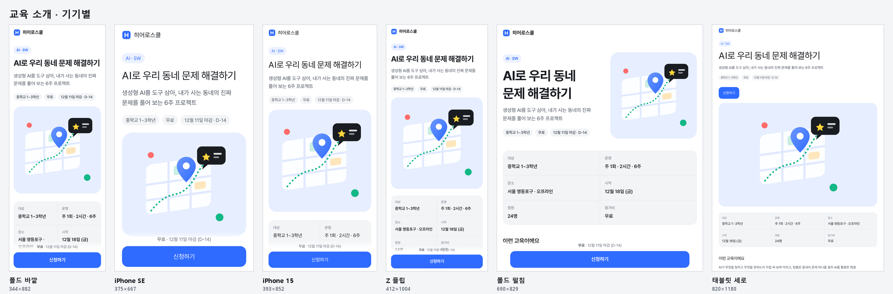
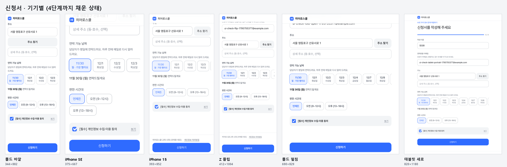
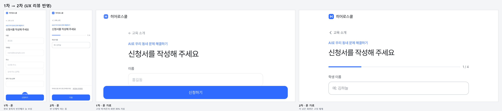
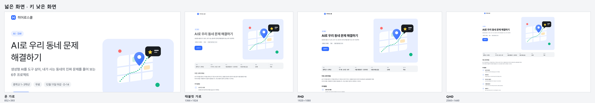
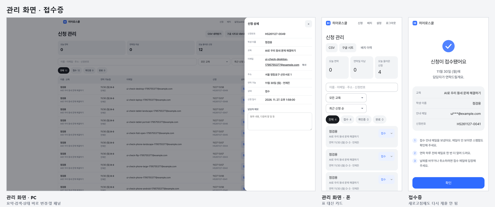
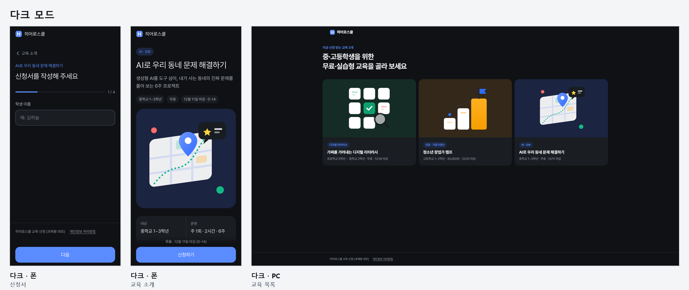

# 교육 신청 시스템

[](https://github.com/chogunwoo155-design/edu-apply/actions/workflows/ci.yml)

교육 소개 → 신청 접수 → 신청 관리 흐름을 Django · PostgreSQL · DRF로 만들었습니다.
샘플 교육 3개는 과제용 가상 데이터입니다.

## 데모

**https://edu-apply.onrender.com**

| 화면 | 주소 |
|---|---|
| 교육 소개 · 신청 | https://edu-apply.onrender.com/ |
| 신청 관리 (로그인 필요) | https://edu-apply.onrender.com/manage/ — 계정 `demo`, 비밀번호는 회신 메일에 적었습니다 |
| API | https://edu-apply.onrender.com/api/courses/ |

- Render 무료 플랜(싱가포르)에 [`render.yaml`](render.yaml) 하나로 웹과 PostgreSQL 17을 올렸습니다. `main`에 push하면 다시 배포됩니다.
- 15분 동안 접속이 없으면 서버가 잠듭니다. **잠든 뒤 첫 접속은 30초~1분** 걸리고, 그다음부터는 바로 열립니다.
- 데모에는 메일 서버를 붙이지 않았습니다. 발송 기록은 Django admin(`/admin/` → 발송 기록)에, 메일 본문은 서버 로그에 남습니다.
- 무료 플랜에는 예약 작업이 없어서, 서버가 깰 때마다 일일 배치를 한 번 돌립니다([`deploy/render_start.sh`](deploy/render_start.sh)). 배치가 멱등이라 여러 번 돌아도 같은 안내를 두 번 보내지 않습니다. 운영 구성(AWS)은 [`docs/DEPLOY_AWS.md`](docs/DEPLOY_AWS.md)에 있습니다.



## 이 저장소를 읽는 순서

이 과제는 대부분의 지원자가 AI로 만들 것이라고 보고, **결과물보다 과정이 보이게** 구성했습니다.

| 순서 | 볼 것 | 내용 |
|---|---|---|
| 1 | 커밋 `1차: …` | 요구사항 그대로 만든 첫 버전 |
| 2 | [`docs/review/`](docs/review/) | 1차를 독립 리뷰어 두 명이 따로 보고 찾은 흠 (코드·운영, 화면·사용성). 고치지 않고 그대로 둠 |
| 3 | 커밋 `2차-1~3` | 리뷰를 근거로 고친 것: 서비스 계층 리팩토링, 멱등한 배치, 토스식 신청 흐름 |
| 4 | [`docs/IMPROVEMENT_LOG.md`](docs/IMPROVEMENT_LOG.md) | 리뷰 항목마다 어떻게 처리했는지(못 한 것과 이유 포함) |
| 5 | [`docs/REFACTORING.md`](docs/REFACTORING.md) | 1차를 "운영 중인 서비스"로 보고 고친 기록: 전/후 구조, 트랜잭션, 데이터 마이그레이션, 쿼리 수 |

공고의 주요 업무 중 **배치·자동화 작업 개발**과 **기존 서비스 개선·리팩토링**은 각각 [배치](#배치--자동화)와 [리팩토링 기록](docs/REFACTORING.md)으로 미리 보여 드리려고 했습니다.

## 과제 항목

| 항목 | 구현 | 어디 |
|---|---|---|
| **필수** 교육 소개 페이지 | 교육명·한 줄 소개·핵심 정보·커리큘럼·FAQ·대표 일러스트(사람 사진 없음) | `/courses/<slug>/` |
| **필수** 교육 신청 페이지 | 이름·이메일·주소·연락 가능 날짜. 한 단계씩 여는 폼, 카카오 주소 찾기, 평일 날짜 칩, Ajax 제출, 13개 기기 반응형 | `/courses/<slug>/apply/` |
| **필수** 신청 관리 | 저장·조회·수정·삭제, 상태(접수/확인중/완료)와 변경 이력. 관리 화면 + Django admin | `/manage/`, `/admin/` |
| **필수** 백엔드·API | Django 5.2 + PostgreSQL 17 모델, DRF GET/POST(+관리자 PATCH/DELETE) | `/api/` |
| 있으면 좋음: 자동 안내 메일 | 접수 확인 메일, **연락일 하루 전** 안내 메일(매일 배치), 담당자 아침 요약 | `automation/` |
| **우대** 관리자 전용 페이지 | 오늘 연락·연락일 지남 요약, 검색·필터·정렬, 그 자리 상태 변경·되돌리기, 상세·메모, 폰 카드 목록 | `/manage/` |
| **우대** Google Spreadsheet 내보내기 | 서비스 계정으로 전체 스냅샷 덮어쓰기(멱등). 관리 화면 버튼 + 매일 배치. CSV 내려받기도 | `automation/sheets.py` |
| **우대** AWS 배포 계획 | ECS Fargate + RDS + EventBridge Scheduler + SES. Dockerfile·compose·CI | [`docs/DEPLOY_AWS.md`](docs/DEPLOY_AWS.md) |
| **우대** AI 도구 사용 내역 | 무엇을 AI에 맡기고 무엇을 사람이 정했는지 | [`docs/AI_USAGE.md`](docs/AI_USAGE.md) |

## 실행 방법

### 1) 로컬 (Python 3.12+ · PostgreSQL)

```bash
python -m venv .venv
source .venv/bin/activate            # Windows: .venv\Scripts\activate
pip install -r requirements-dev.txt

cp .env.example .env                 # DATABASE_URL을 내 PostgreSQL로
createdb edu_apply
python manage.py migrate
python manage.py seed_sample --demo-admin   # 샘플 교육 3개 + 로컬 확인용 관리자(demo)
python manage.py runserver
```

- 교육 목록 http://127.0.0.1:8000/
- 관리 화면 http://127.0.0.1:8000/manage/ — 로컬 확인용 계정 `demo` (비밀번호는 `courses/management/commands/seed_sample.py`의 `DEMO_ADMIN`). 운영에서는 `createsuperuser`를 씁니다.
- 메일은 로컬에서 콘솔에 찍힙니다(`EMAIL_BACKEND`).

### 2) Docker

```bash
docker compose up --build           # http://localhost:8000
docker compose run --rm web python manage.py seed_sample --demo-admin
docker compose --profile batch run --rm batch   # 매일 배치를 한 번 돌려 보기
```

compose는 로컬 확인용입니다(`DEBUG=1`). 운영 구성은 [`docs/DEPLOY_AWS.md`](docs/DEPLOY_AWS.md)에 있습니다.

## 테스트

```bash
python -m pytest            # 33개. PostgreSQL에서 돈다 (CI도 같은 PostgreSQL 17)
```

| 파일 | 보는 것 |
|---|---|
| `tests/test_api.py` | 공개 신청·검증(날짜·마감·정원·중복·동의·제어 문자)·요청 제한·메일 실패·관리자 API·쿼리 수 |
| `tests/test_batch.py` | 재실행해도 한 통, 한 건 실패 후 재시도, dry-run, 하루 한 번 요약, 실패 기록·종료 코드, 시트 내보내기 |
| `tests/test_manage.py` | 권한, 필터·개수, 상태 검증, 외부 주소로 돌려보내기 차단, CSV 수식 실행 방지, 한국 시간 경계, 쿼리 수 |

리뷰에서 나온 결함의 회귀 테스트는 docstring에 "1차: …"로 무엇이 깨져 있었는지 적었습니다.

### 기기별 화면 점검

```bash
playwright install chromium webkit
# 점검은 신청을 실제로 넣으므로 점검 전용 DB로 띄운 서버에 돌린다
DATABASE_URL=postgres://.../edu_apply_ui APPLY_RATE_LIMIT=1000/hour python manage.py runserver 8765
python tools/ui_check.py --base http://127.0.0.1:8765 --out var/shots --admin demo:<비밀번호>
```

Chromium·WebKit으로 13개 기기 크기(폴드 바깥 344px, 작은 폰·큰 폰, 플립, 폰 가로, 폴드 펼침, 태블릿 세로·가로, 노트북, FHD, QHD)를 열어 검사합니다.
- 화면마다: 가로 넘침, 손가락 크기(44px) 미만 버튼, `hidden`인데 보이는 요소, 하단 버튼이 내용 칸보다 넓은지, 고정 영역이 화면을 30% 넘게 가리는지
- 흐름: 신청서를 단계별로 채워 제출 → 접수증, 관리 화면 로그인 → 상세 패널
- 다크 모드 (폰·PC)

현재 결과: **71개 항목 통과**. 1차에서 이 도구가 놓친 두 가지를 리뷰가 잡아서 검사를 더했습니다([개선 기록](docs/IMPROVEMENT_LOG.md#리뷰가-잡아-준-것-중-1차-점검이-놓친-것)).



## 배치 · 자동화

```bash
python manage.py run_daily_jobs                      # 오늘(KST) 기준 전체
python manage.py run_daily_jobs --dry-run            # 보내지 않고 대상 건수만
python manage.py run_daily_jobs --date 2026-12-01    # 그날 기준으로 다시 돌리기
python manage.py run_daily_jobs --only staff_digest --force
```

| 순서 | 작업 | 하는 일 |
|---|---|---|
| 1 | `retry_failed_notifications` | 지난번 실패한 메일(접수 확인 포함) 재발송, 최대 5회 |
| 2 | `contact_reminders` | 연락 가능 날짜가 **내일**인 신청자에게 안내 메일 |
| 3 | `staff_digest` | 담당자에게 오늘 연락할 사람 + 3일 넘게 '접수'로 남은 신청 (하루 한 번) |
| 4 | `export_sheet` | 구글 시트에 전체 신청 목록 덮어쓰기 (설정이 없으면 건너뜀) |

- **멱등**: (신청, 메일 종류)마다 `NotificationLog` 한 줄 + 유니크 제약. 몇 번을 다시 돌려도, 스케줄러가 재시도해도 한 통입니다.
- **실패 격리**: 한 건이 실패해도 나머지는 보내고, 실패 건은 다음 실행에서 다시 보냅니다. 작업 하나가 실패해도 다음 작업은 돕니다.
- **기록**: 작업마다 `JobRun`(시작·끝·처리 건수·오류). 관리 화면 "배치 이력"에서 봅니다. 하나라도 실패하면 종료 코드 1이라 스케줄러가 알릴 수 있습니다.
- **스케줄**: 운영은 EventBridge Scheduler가 매일 08:00 KST에 같은 이미지로 실행합니다. cron이면 `0 8 * * * cd /app && python manage.py run_daily_jobs`.

### 구글 시트 연결

1. Google Cloud에서 서비스 계정을 만들고 키(JSON)를 받습니다. Google Sheets API를 켭니다.
2. 내보낼 스프레드시트를 서비스 계정 이메일에 **편집자**로 공유합니다.
3. 환경 변수: `GOOGLE_SHEET_ID`(URL의 `/d/<ID>/`)와 `GOOGLE_SERVICE_ACCOUNT_FILE`(키 파일 경로) 또는 `GOOGLE_SERVICE_ACCOUNT_JSON`(키 내용).
4. 관리 화면의 "구글 시트로 내보내기" 버튼 또는 `run_daily_jobs --only export_sheet`.

시트에는 `RAW`로 써서 이름 칸에 `=`로 시작하는 값이 있어도 수식으로 실행되지 않습니다. CSV 내려받기도 같은 이유로 위험한 첫 글자 앞에 `'`를 붙입니다.

> 실제 Google 계정 연결은 이 과제에서 확인하지 못했습니다. 내보내기 로직은 가짜 시트 객체로 테스트했습니다(`test_export_sheet_writes_snapshot`).

## API

| 메서드 | 주소 | 권한 | 설명 |
|---|---|---|---|
| GET | `/api/courses/` · `/api/courses/<slug>/` | 누구나 | 교육 목록·상세(커리큘럼 포함) |
| POST | `/api/applications/` | 누구나 (IP당 시간당 10회) | 신청. 응답은 접수증(신청번호·접수증 주소). 주소 등은 되돌려주지 않음 |
| GET | `/api/applications/?status=&course=&q=` | 관리자 | 목록·검색 |
| GET · PATCH · DELETE | `/api/applications/<id>/` | 관리자 | 조회·수정(상태는 서비스를 거쳐 이력이 남음)·삭제 |
| GET | `/api/applications/summary/` | 관리자 | 상태별 건수 |
| GET | `/healthz` | 누구나 | 앱·DB 헬스 체크(ALB용) |

신청 요청 예:

```json
{
  "course": "ai-problem-solving",
  "name": "김하늘",
  "email": "parent@example.com",
  "postcode": "07276",
  "address": "서울 영등포구 선유서로25길 28",
  "address_detail": "1208호",
  "contact_date": "2026-12-01",
  "contact_time": "afternoon",
  "privacy_agreed": true
}
```

오류는 칸마다 사람이 읽을 문장으로 돌려줍니다. 예: `{"contact_date": ["주말에는 연락드리기 어려워요. 평일을 골라 주세요."]}`

## 설계 의도

**규칙은 한 곳에.** 신청 가능 여부·연락 날짜 규칙은 `applications/rules.py`, 쓰기는 `services.py`, 읽기는 `selectors.py`에 있습니다. API·관리 화면·admin·배치는 이 함수들만 부릅니다. 화면의 날짜 칩도 서버가 계산해 내려 주므로, 브라우저 시계나 시간대에 따라 규칙이 달라지지 않습니다.

**DB가 마지막 방어선.** 중복 신청(대소문자 무시)과 상태값은 서비스가 먼저 막고, 놓쳐도 DB 제약이 막습니다. 정원은 교육 행을 잠그고 셉니다.

**신청자의 시간을 줄인다.** 한 화면에 한 가지만 묻고(이름 → 이메일 → 주소 → 날짜), Enter는 다음 칸으로, 주소는 검색으로, 날짜는 칩으로 고릅니다. 오류는 칸을 떠날 때 바로 보여 주고, 제출 뒤에는 서명된 접수증 페이지로 옮겨 새로고침해도 다시 제출되지 않습니다.

**담당자의 하루를 기준으로.** 관리 화면은 "오늘 누구에게 연락하나"부터 보여 줍니다. 상태는 그 자리에서 바꾸고 되돌릴 수 있고, 아침 요약 메일이 놓친 건을 알려 줍니다.

**운영에서 실패하는 방식까지.** 메일이 실패해도 신청은 성공하고 배치가 다시 보냅니다. 배치는 몇 번을 돌려도 같은 결과입니다. 운영 설정은 빠진 값이 있으면 조용히 넘어가지 않고 기동을 멈춥니다.

## 구조

```
config/            설정(환경 변수), URL, 헬스 체크
courses/           교육·커리큘럼 모델, 소개 페이지, 샘플 데이터 명령
applications/      신청 모델·이력, rules / services / selectors, API, 신청서·접수증·관리 화면
automation/        발송 기록·배치 기록 모델, mailer(메일 단일 출구), jobs(배치), sheets(구글 시트), run_daily_jobs
templates/         화면·메일 템플릿
static/            CSS(디자인 토큰·다크 모드·반응형), JS(신청서·관리 화면·공통 UI), 일러스트
tests/             pytest 33개
tools/             ui_check.py(기기별 점검), make_gallery.py(README 이미지)
docs/              리뷰·개선 기록·리팩토링 기록·AWS 계획·AI 사용 내역·캡처
```

## 화면





