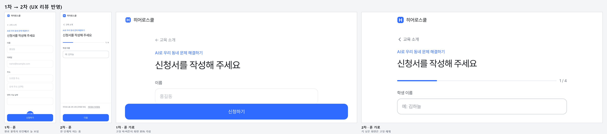

# 개선 기록 — 1차 → 리뷰 → 2차

1차를 만든 뒤, 만든 쪽과 다른 눈으로 다시 보게 했습니다. 독립 리뷰어 두 명이 1차 커밋만 보고 흠을 찾았습니다.

- 코드·운영 리뷰: [`docs/review/CODE_REVIEW.md`](review/CODE_REVIEW.md) (재현 스크립트 `docs/review/scratch/`)
- 화면·사용성 리뷰: [`docs/review/UX_REVIEW.md`](review/UX_REVIEW.md) (캡처 `docs/review/ux/shots/`)

두 리포트는 고치지 않고 그대로 남겼습니다. 아래는 각 항목을 어떻게 처리했는지입니다.

## 리뷰가 잡아 준 것 중 1차 점검이 놓친 것

1차에도 기기 13종 자동 점검을 돌렸고 52개 항목이 모두 통과했습니다. 그런데 리뷰에서 **막음** 등급이 두 개 나왔습니다.

| 놓친 것 | 왜 놓쳤나 | 점검 도구에 더한 검사 |
|---|---|---|
| 완료 화면이 폼 아래에 늘 보임 (`.done{display:grid}`가 `hidden`을 이김) | 점검은 "제출하면 완료가 뜨는가"만 봤고, "제출 전에는 안 보이는가"를 보지 않았다 | `hidden` 속성인데 화면에 그려지는 요소가 있으면 실패 |
| QHD에서 하단 버튼이 2560px로 늘어남 | 넘침(가로 스크롤)만 봤고 "너무 넓은 것"은 문제로 보지 않았다 | 하단 버튼이 내용 칸(640px)보다 넓으면 실패 |
| 폰 가로에서 고정 바·버튼이 화면 35%를 가림 | 가림 정도를 재지 않았다 | 고정 영역이 화면 높이의 30%를 넘으면 실패 |

2차 점검: 13개 기기 × (화면 3개 + 신청 제출 + 관리 화면) + 다크 모드 2개 기기 = **71개 항목 통과**. 숫자가 통과해도 캡처를 직접 열어 봤고, 그렇게 찾은 것(요일이 "화요일요일"로 나옴, 관리 화면 폰 메뉴 줄바꿈, 버튼 글자 사이 틈)도 고쳤습니다.

---

## 코드·운영 리뷰 처리

| 리뷰 | 내용 | 처리 |
|---|---|---|
| 1, D1 | 문서가 없는 배치 코드를 약속 | 문서대로 구현: `run_daily_jobs`, `JobRun`, `NotificationLog` |
| 2, D2~D4 | 배치 재실행 시 중복 발송, 한 건 실패 시 중단, dry-run·날짜·기록 없음 | 고침 → [리팩토링 기록 4절](REFACTORING.md#4-배치를-멱등하게) |
| 3, B1 | 신청 API로 남의 주소에 메일 폭탄 | IP당 시간당 10회 제한, 숨은 칸(봇), 같은 교육·이메일 중복 차단 |
| 4, D5 | 메일 동기 발송, 실패 시 500 | 커밋 뒤 발송, 실패해도 201, 배치 재시도 |
| 5, C1 | 중복 신청 | 서비스 검사 + DB 유니크 제약 + 기존 중복 병합 마이그레이션 |
| 6, A1, C2 | 관리 화면 상태값 검증 없음, 값 없으면 500 | 서비스 검증(400) + `CheckConstraint` + 변경 이력 |
| 7, A2 | 마감일·정원 무시 | `rules.course_availability()` + 교육 행 잠금 |
| 8, B3 | 운영 메일 기본값이 콘솔(개인정보가 로그로) | `DEBUG=0`이면 SMTP 기본, `EMAIL_HOST` 없으면 기동 실패 |
| 9, B2 | compose가 DEBUG=1 + 알려진 비밀번호 관리자 자동 생성 | 로컬 전용이라고 명시, 관리자 계정은 명령으로만 |
| 10, A3, A4 | 당일 신청은 안내 메일 누락, 날짜 최소값이 시간대 따라 바뀜 | 가장 빠른 날 = 내일(KST), 안내는 하루 전, 서버가 날짜를 내려 줌 |
| 11, F1 | 서비스 계층 없음 | `services.py`·`selectors.py`·`rules.py`·`mailer.py` |
| 12, H1~H4 | 테스트 6개 | 33개 (API·배치·관리 화면·시간대 경계·쿼리 수) |
| A5, A6 | 날짜 상한 없음, 제어 문자·우편번호 검사 없음 | 30일 상한, 제어 문자 거부, 우편번호 5자리 |
| A7 | 관리자 PATCH로 과거 날짜 | 과거·주말 거부 (담당자는 오늘로 당기기 가능) |
| A8 | JSON 아닌 응답을 "네트워크 오류"로 | 응답 형식·상태 코드별 문구 |
| B4, B5 | HSTS 없음, 운영에 Browsable API | HSTS·SSL 리다이렉트(헬스 체크 제외), 운영은 JSON만 |
| B6 | 상태 변경 이력 없음 | `ApplicationStatusLog`(누가·언제·무엇에서 무엇으로). 개인정보 조회 기록은 하지 않음(아래) |
| C3 | seed가 관리자가 고친 교육을 덮어씀 | 없는 것만 만들기, `--reset`일 때만 덮어씀 |
| D6, E1~E3 | N+1 | 고침 → [리팩토링 기록 5절](REFACTORING.md#5-쿼리-수) |
| D7 | 담당자 알림 설정을 안 씀 | 아침 담당자 요약 메일(오늘 연락, 3일 넘게 방치된 접수) |
| D8 | 당일 아침 안내보다 전날 안내가 유용 | 하루 전 안내로 바꿈 |
| F2, F3 | URL 앱 경계 섞임, 상태 변경 후 필터 풀림 | 신청 URL을 `applications/urls.py`로, `next` 유지(외부 주소 차단), 관리 화면은 그 자리 변경 |
| G1 | CI `check --deploy`가 늘 통과 | `--fail-level WARNING` |
| G2 | DB 주소 없으면 조용히 기본값 | 운영은 필수, `conn_health_checks` |
| G4 | 운영·개발 의존성 한 파일, 안 쓰는 패키지 | `requirements.txt` / `requirements-dev.txt` 분리, 구글 시트 코드 구현 |
| G5 | README 없음 | 작성 |
| G6 | gunicorn 타임아웃 없음 | `--timeout 30 --graceful-timeout 20` |
| G3 | 테스트는 Manifest 정적 파일 저장소를 안 씀 | **미처리**. 대신 CI의 Docker 빌드가 `DEBUG=0`으로 `collectstatic`(Manifest)을 돌려 없는 파일 참조를 잡음 |

## 화면·사용성 리뷰 처리

| 리뷰 | 내용 | 처리 |
|---|---|---|
| 1, F1 | 완료 화면이 늘 보임 | 전역 `[hidden]{display:none!important}` + 점검 도구 검사 추가 |
| 2, R1, R2 | 넓은 화면 하단 버튼이 화면 폭 | 768px 이상·키 낮은 화면은 고정 해제, 폭은 내용 칸에 맞춤 |
| 3, F2 | DRF 기본 번역 오류 문구 | 칸마다 문장: "학생 이름을 적어 주세요" 등 (`test_error_messages_are_korean_sentences`) |
| 4, F3 | 주소 검색 없음 | 카카오 우편번호(키 필요 없음), 고르면 우편번호 채우고 상세 주소로 이동, 못 불러오면 직접 입력 |
| 5, F4, F5 | 날짜 고르기 불편, UTC | 평일 10개 칩 + "다른 날"(달력), 서버가 범위를 내려 줌, 고른 날을 "12월 1일 (화)"로 다시 보여 줌 |
| 6, F14 | 개인정보 동의 없음 | 필수 동의 + 바텀시트(항목·목적·보관 기간), 처리방침 페이지, 14세 미만은 보호자 신청 안내 |
| 7, F8, F9 | 모든 오류가 "네트워크 오류" | 400(칸별)·403·429·5xx·오프라인·시간 초과 문구 분리, 다시 시도 버튼, "두 번 접수되지 않아요" 안내 |
| 8, F13 | 누구 정보인지 모름 | "학생 이름", "연락받을 이메일(보호자도 괜찮아요)" — 필드는 과제 명세대로 |
| 9, M1, M2 | 상태 변경 시 새로고침·필터 풀림 | PATCH로 그 자리 변경 + 토스트 + 되돌리기, 실패하면 원래 값 |
| 10, M3~M5, M8, M13 | 개수·검색·상세 없음 | 오늘 연락·연락일 지남·오늘 신청 요약, 상태별 개수, 검색(이름·이메일·주소·신청번호), 교육·정렬, 연락일 D-day, 옆 패널 상세·메모 자동 저장·이메일 복사 |
| 11, M6, M7 | 폰에서 관리 화면 못 씀 | 768px 미만은 카드 목록, 상태 선택 44px |
| 12, F6, F7 | Enter로 바로 제출, 오류 늦음 | 한 단계씩 여는 폼, Enter는 다음 칸, 떠날 때 검사·입력하면 지움, 첫 오류 칸으로 이동 |
| 13, D1~D7 | 완료 화면 마무리 부족, 새로고침하면 빈 폼 | 서명된 접수증 페이지로 이동(`location.replace`), 요약 카드·다음 단계·확인 버튼, 제목에 포커스 |
| 14, R3~R5, L1, L2 | 폰 가로·폴드 펼침 첫 화면이 그림 | 키 낮은 화면은 고정 해제, 폴드 펼침·태블릿은 2단, 핵심 정보 칩을 그림 위로, 버튼 위 "무료 · 마감일 (D-14)" |
| 15, K1~K4 | 다크 모드 없음 | 다크 토큰, `color-scheme`, 테마 색, 일러스트 배경 투명 |
| F10, F11 | 진행 표시 없음, 새로고침하면 입력 사라짐 | 스피너 + "신청하는 중…", 같은 탭 임시 저장(`sessionStorage`, 탭 닫으면 사라짐) |
| F15 | 이메일 오타 | "gmial.com → gmail.com 아닌가요?" 제안 |
| L3 | 시작일·남은 자리·FAQ 없음 | 시작일, 5자리 이하일 때 남은 자리, FAQ 3개 |
| L4, R8 | 카드 정보 부족, 넓은 화면 휑함 | 참가비·마감일, 마감 카드 흐리게, 넓은 화면 2~3열 |
| L5 | "AI가 만든 템플릿" 느낌 | 일러스트를 교육 내용(동네 지도·핀, 팩트 체크, 계단과 깃발)으로 다시 그림, 문구를 구체적으로 |
| L6, L7 | 장식 그림 alt 중복, 파비콘·푸터 없음 | `alt=""`, 파비콘, 푸터 |
| A1~A10 | 대비, 오류 색, 포커스, 동작 줄이기, 건너뛰기 링크, caption | 회색 글 4.8:1, 오류 글자 진하게, 입력칸 테두리 진하게, 포커스 링, `prefers-reduced-motion`, 본문 건너뛰기, `aria-describedby`, 표 caption |
| M12 | 영어 "Django admin", 로그아웃 없음 | 관리 메뉴(신청·배치·설정·로그아웃), admin 제목 한국어 |
| M14 | 점검 도구가 실제 DB를 채움 | 점검 전용 DB로 띄운 서버에 돌리도록 README에 명시, 기기마다 다른 이메일 |
| M9 | 상태 구분이 안 됨 | 상태별 색 칩(접수 파랑·확인중 주황·완료 초록) |
| M10 | "완료"가 모호 | **미처리**: 과제 명세의 상태 이름(접수/확인중/완료)을 지킴 |
| M11 | 여러 건 한 번에 바꾸기 | **미처리**: 시간 관계상 제외. CSV 내려받기는 함 |
| R10 | 윈도 WebKit에서 굵은 글씨가 얇게 보임 | **확인 못 함**: 실제 iPhone Safari가 없어 확인하지 못했습니다 |

## 일부러 하지 않은 것

- **개인정보 조회 기록**(누가 어떤 신청을 열어 봤는지): 상태 변경 이력만 남깁니다. 운영에서는 상세 패널 열람도 기록하는 게 맞습니다.
- **만 14세 미만 법정대리인 동의 절차**: 안내 문구만 넣었습니다. 실제 절차는 법무 확인이 필요합니다.
